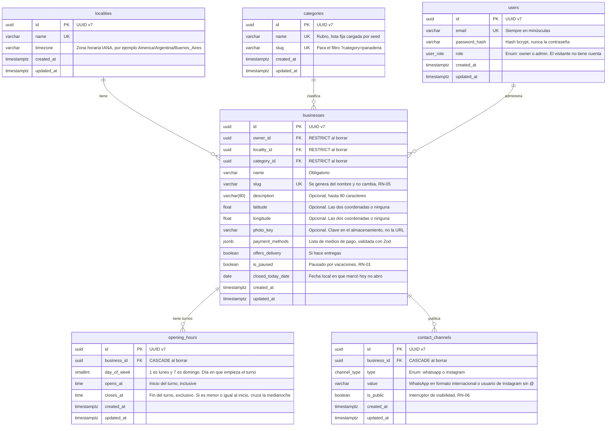

# AcáNomás — Modelo de datos

Este documento muestra cómo se organiza la base de datos de AcáNomás: qué tablas hay, qué guarda cada una y cómo se relacionan. Es el diagrama entidad-relación (ER) de la tarea de diseño del modelo de datos de EP-00.

## Historial de versiones

| Versión | Fecha | Autor | Cambios |
|---|---|---|---|
| 0.1 | 03/11/2026 | Equipo AcáNomás | Borrador para revisión del equipo |
| 0.2 | 03/11/2026 | Equipo AcáNomás | Se aclara que el visitante no tiene cuenta y los roles de `users` |
| 0.3 | 04/11/2026 | Tobias | Aplica la revisión: enums en lugar de texto libre, `photo_key` en lugar de `photo_url`, restricciones `CHECK`, comportamiento al borrar, índices, `slug` en rubros, UUID v7 y fechas de auditoría en todas las tablas |
| 1.0 | 05/11/2026 | Tobias | El equipo aprueba el modelo: D-22 pasa a `Aceptada` |

## Índice

1. Diagrama entidad-relación
2. Tablas
3. Qué va en columnas, en tablas, en enums y en JSONB
4. Reglas que no controla la base de datos
5. Decisiones del modelo

---

## 1. Diagrama entidad-relación

El diagrama usa los nombres de la base de datos (inglés, `snake_case`, plural), según D-07 y D-08. Una relación `||--o{` se lee "uno a muchos": por ejemplo, una localidad tiene muchos negocios.

---

## 2. Tablas

| Tabla | Qué guarda | Requisitos que cubre |
|---|---|---|
| `localities` | Ciudad o pueblo y su zona horaria. El MVP tiene una sola (Corrientes Capital) | D-12, RN-01 |
| `categories` | Rubros con su `slug`. Lista fija cargada por seed | RF-03 |
| `users` | Cuentas con email, contraseña con hash y rol (`owner` o `admin`) | RF-13, RF-14, D-10 |
| `businesses` | La ficha del negocio: datos básicos, ubicación, foto, medios de pago, entregas, pausa y "hoy no abro" | RF-08, RF-16, RF-18, RF-19, RF-20, RF-24, RF-25 |
| `opening_hours` | Un turno por fila: día de la semana, hora de inicio y hora de fin | RF-22, RN-02, RN-03 |
| `contact_channels` | Un canal de contacto por fila, con su interruptor de visibilidad | RF-10, RF-17, RN-06 |

**Enums:**

| Enum | Valores | Lo usa |
|---|---|---|
| `user_role` | `owner`, `admin` | `users.role` |
| `channel_type` | `whatsapp`, `instagram` | `contact_channels.type` |
Un enum hace que la base rechace los valores inválidos (`"ownr"`, `"whatsap"`). Agregar un valor nuevo requiere una migración, y está bien: es un cambio que decide el equipo.

**Restricciones que no se ven en el diagrama:**

- `contact_channels`: la combinación (`business_id`, `type`) es única. Un negocio no repite canal.
- `businesses.slug` y `categories.slug` son únicos. El de los negocios nunca se actualiza (RN-05).
- `opening_hours.day_of_week` solo admite valores de 1 a 7 (`CHECK`).
- `businesses.latitude` y `businesses.longitude` van las dos o ninguna (`CHECK`).
- `businesses.payment_methods` siempre es una lista JSON (`CHECK (jsonb_typeof(payment_methods) = 'array')`), con `[]` por defecto.
- Un negocio sin filas en `opening_hours` se considera cerrado todos los días (RN-03).
- Un negocio sin fila de un canal en `contact_channels` no tiene ese canal cargado (RN-06).
- `users.role` solo admite `owner` y `admin`. El visitante no tiene cuenta (ERS 2.2), así que no es un usuario ni tiene fila en ninguna tabla: usa solo la API pública. Si más adelante se agregan cuentas de vecinos, se suma un valor nuevo al enum con una migración.

**Qué pasa al borrar:**

| Se borra | Efecto | Por qué |
|---|---|---|
| Un negocio | Se borran sus turnos y canales (`CASCADE`) | No tienen sentido sin el negocio |
| Un usuario con negocios | No se permite (`RESTRICT`) | Evita perder fichas por accidente: primero se resuelven sus negocios |
| Un rubro o una localidad en uso | No se permite (`RESTRICT`) | Un negocio siempre tiene rubro y localidad |

**Índices** (PostgreSQL no crea índices solos en las claves foráneas):

| Índice | Para qué |
|---|---|
| `businesses(locality_id)` | El listado filtra por localidad en cada request |
| `businesses(category_id)` | Filtro por rubro (US-03) |
| `businesses(owner_id)` | El panel busca los negocios del dueño |
| `opening_hours(business_id)` | `isOpenNow` lee los turnos de cada negocio |

**Identificadores:** UUID v7. A diferencia del v4, que es totalmente aleatorio, empieza con la fecha de creación, así que los registros nuevos quedan ordenados y el índice de la clave primaria rinde mejor. En Prisma: `@default(uuid(7))`.

---

## 3. Qué va en columnas, en tablas, en enums y en JSONB

Regla de D-03: el modelo es relacional y `JSONB` se usa solo donde el dato es flexible o anidado.

| Dato | Dónde | Por qué |
|---|---|---|
| Foto | Columna `photo_key` | El MVP tiene una sola foto por negocio. La imagen vive en el almacenamiento (D-14), no en la base. Se guarda la clave (`businesses/7f3a.webp`) y el adaptador arma la URL según el entorno; así, cambiar de almacenamiento o de entorno no rompe las fotos |
| Ubicación | Columnas `latitude` y `longitude` | La distancia se calcula en la aplicación con Haversine, sin PostGIS (D-05) |
| Horarios | Tabla `opening_hours`, un turno por fila | Hasta dos turnos por día, y `isOpenNow` los lee todos juntos |
| Canales de contacto | Tabla `contact_channels` | Cada canal tiene su propia visibilidad, y agregar otro canal no cambia el esquema |
| Medios de pago | `JSONB` en `payment_methods` | Es una lista de etiquetas sin relaciones ni consultas, que solo se muestra en la ficha. La base no valida los valores, así que el esquema Zod acepta solo los permitidos (`z.array(z.enum([...]))`), y un `CHECK` asegura que siempre sea una lista |
| Entregas | Columna booleana `offers_delivery` | Es un sí o no |
| Pausa | Columna booleana `is_paused` | Es un sí o no, y tiene la mayor precedencia en RN-01 |
| Hoy no abro | Columna `closed_today_date` (fecha) | Se guarda la fecha local, así vence sola cuando cambia el día (US-23) |
| Zona horaria | Columna `localities.timezone` | Cada localidad tiene la suya (D-12) |

**El estado "abierto ahora" no se guarda.** Se calcula cada vez con `isOpenNow(hours, now, timezone)` a partir de `is_paused`, `closed_today_date` y `opening_hours` (RN-01 y RN-10).

**Un turno pertenece al día en que empieza.** El turno lunes 19:00–03:00 se guarda con `day_of_week = 1` (lunes), aunque termine el martes (RN-02). Así se valida la superposición de turnos y se calcula el estado.

---

## 4. Reglas que no controla la base de datos

Las valida el servicio o el esquema Zod antes de guardar:

| Regla | Dónde se valida |
|---|---|
| Hasta dos turnos por día y sin superposición (RF-22) | Servicio de horarios |
| Contraseña de al menos 8 caracteres (RF-13) | Esquema Zod de registro |
| Email en minúsculas antes de guardar o buscar, para que `Juan@mail.com` y `juan@mail.com` sean la misma cuenta (RF-13) | Esquema Zod de registro y de login |
| Descripción de hasta 80 caracteres (RF-16) | Esquema Zod, y `varchar(80)` en la base |
| Medios de pago solo de la lista permitida, sin repetidos (RF-18) | Esquema Zod de la ficha |
| WhatsApp en formato internacional (`5493794123456`) e Instagram sin `@` (RF-17) | Esquema Zod de contacto |
| Un dueño solo modifica sus propios negocios (RN-07) | `requireAuth` y verificación de propiedad |
| Foto en JPG, PNG o WebP de hasta 5 MB (RF-20) | Endpoint de subida |
| Generación del slug a partir del nombre (RN-05) | Servicio de negocios |
| Un campo oculto no sale en la API pública (RN-06) | Servicio de negocios |

**Pendiente de US-02:** la búsqueda sin distinguir tildes (RF-02) se decide en esa historia. Puede sumar la extensión `unaccent` de PostgreSQL o una columna con el texto normalizado, y en ese caso cambia el esquema.

---

## 5. Decisiones del modelo

El equipo aprobó estas elecciones el 05/11/2026 y quedaron registradas en D-22 (`decisiones.md`). La columna "Alternativa" muestra lo que se descartó.

| Tema | Elección | Alternativa |
|---|---|---|
| Tipo de los identificadores | UUID v7 | UUID v4 (aleatorio) o números enteros autoincrementales |
| Tabla de cuentas | Una sola tabla `users` con la columna `role` (D-10 habla de los roles `owner` y `admin`) | Tabla `owners` separada |
| Rubro del negocio | Obligatorio (`category_id` no nulo) | Opcional |
| Foto | Una columna `photo_key` con la clave en el almacenamiento | URL completa (se rompe al cambiar de entorno) o tabla `business_photos` si se quieren varias fotos |
| Medios de pago | `JSONB` validado con Zod | Lista de un enum de PostgreSQL (la base valida los valores) o tabla `payment_methods` con relación muchos a muchos |
| Valores permitidos de medios de pago | Efectivo, transferencia, tarjeta y Mercado Pago (`cash`, `transfer`, `card`, `mercado_pago`) | Otra lista |
| Borrar un usuario con negocios | No se permite (`RESTRICT`) | Borrar sus negocios en cascada |
| Dueño con varios negocios | El modelo lo permite (relación uno a muchos) y la interfaz del MVP muestra uno | Sigue "a confirmar" en el ERS y en D-20: solo afecta a la interfaz, no al modelo |
