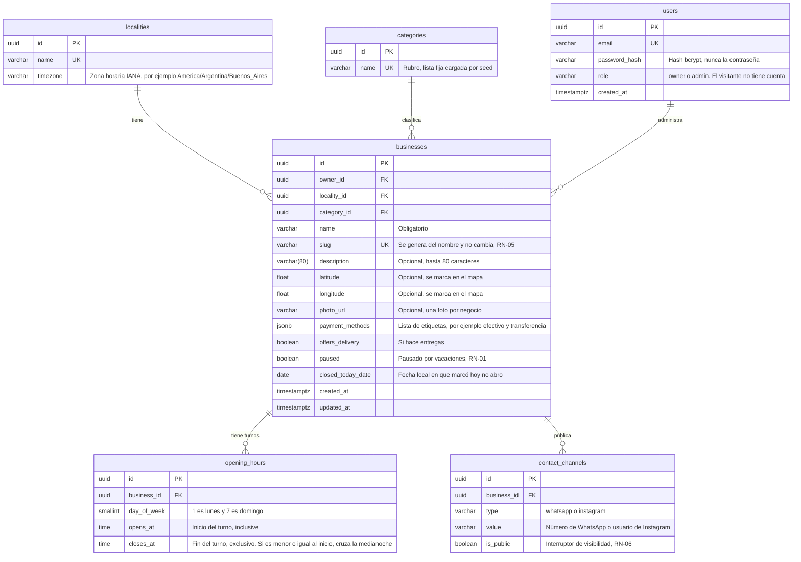

# AcáNomás — Modelo de datos

Este documento muestra cómo se organiza la base de datos de AcáNomás: qué tablas hay, qué guarda cada una y cómo se relacionan. Es el diagrama entidad-relación (ER) de la tarea de diseño del modelo de datos de EP-00.

## Historial de versiones

| Versión | Fecha | Autor | Cambios |
|---|---|---|---|
| 0.1 | 03/11/2026 | Equipo AcáNomás | Borrador para revisión del equipo |
| 0.2 | 03/11/2026 | Equipo AcáNomás | Se aclara que el visitante no tiene cuenta y los roles de `users` |

## Índice

1. Diagrama entidad-relación
2. Tablas
3. Qué va en columnas, en tablas y en JSONB
4. Reglas que no controla la base de datos
5. Decisiones a confirmar

---

## 1. Diagrama entidad-relación

El diagrama usa los nombres de la base de datos (inglés, `snake_case`, plural), según D-07 y D-08. Una relación `||--o{` se lee "uno a muchos": por ejemplo, una localidad tiene muchos negocios.

---

## 2. Tablas

| Tabla | Qué guarda | Requisitos que cubre |
|---|---|---|
| `localities` | Ciudad o pueblo y su zona horaria. El MVP tiene una sola (Corrientes Capital) | D-12, RN-01 |
| `categories` | Rubros. Lista fija cargada por seed | RF-03 |
| `users` | Cuentas con email, contraseña con hash y rol (`owner` o `admin`) | RF-13, RF-14, D-10 |
| `businesses` | La ficha del negocio: datos básicos, ubicación, foto, medios de pago, entregas, pausa y "hoy no abro" | RF-08, RF-16, RF-18, RF-19, RF-20, RF-24, RF-25 |
| `opening_hours` | Un turno por fila: día de la semana, hora de inicio y hora de fin | RF-22, RN-02, RN-03 |
| `contact_channels` | Un canal de contacto por fila, con su interruptor de visibilidad | RF-10, RF-17, RN-06 |

**Restricciones que no se ven en el diagrama:**

- `contact_channels`: la combinación (`business_id`, `type`) es única. Un negocio no repite canal.
- `businesses.slug` es único y nunca se actualiza (RN-05).
- Un negocio sin filas en `opening_hours` se considera cerrado todos los días (RN-03).
- Un negocio sin fila de un canal en `contact_channels` no tiene ese canal cargado (RN-06).
- Al borrar un negocio se borran sus turnos y canales (`ON DELETE CASCADE`).
- `users.role` solo admite `owner` y `admin`. El visitante no tiene cuenta (ERS 2.2), así que no es un usuario ni tiene fila en ninguna tabla: usa solo la API pública. Si más adelante se agregan cuentas de vecinos, se suma un valor nuevo al rol con una migración.

---

## 3. Qué va en columnas, en tablas y en JSONB

Regla de D-03: el modelo es relacional y `JSONB` se usa solo donde el dato es flexible o anidado.

| Dato | Dónde | Por qué |
|---|---|---|
| Foto | Columna `photo_url` | El MVP tiene una sola foto por negocio |
| Ubicación | Columnas `latitude` y `longitude` | La distancia se calcula en la aplicación con Haversine, sin PostGIS (D-05) |
| Horarios | Tabla `opening_hours`, un turno por fila | Hasta dos turnos por día, y `isOpenNow` los lee todos juntos |
| Canales de contacto | Tabla `contact_channels` | Cada canal tiene su propia visibilidad, y agregar otro canal no cambia el esquema |
| Medios de pago | `JSONB` en `payment_methods` | Es una lista de etiquetas sin relaciones ni consultas: el caso típico de dato flexible |
| Entregas | Columna booleana `offers_delivery` | Es un sí o no |
| Pausa | Columna booleana `paused` | Es un sí o no, y tiene la mayor precedencia en RN-01 |
| Hoy no abro | Columna `closed_today_date` (fecha) | Se guarda la fecha local, así vence sola cuando cambia el día (US-23) |
| Zona horaria | Columna `localities.timezone` | Cada localidad tiene la suya (D-12) |

**El estado "abierto ahora" no se guarda.** Se calcula cada vez con `isOpenNow(hours, now, timezone)` a partir de `paused`, `closed_today_date` y `opening_hours` (RN-01 y RN-10).

---

## 4. Reglas que no controla la base de datos

Las valida el servicio o el esquema Zod antes de guardar:

| Regla | Dónde se valida |
|---|---|
| Hasta dos turnos por día y sin superposición (RF-22) | Servicio de horarios |
| Contraseña de al menos 8 caracteres (RF-13) | Esquema Zod de registro |
| Descripción de hasta 80 caracteres (RF-16) | Esquema Zod, y `varchar(80)` en la base |
| Un dueño solo modifica sus propios negocios (RN-07) | `requireAuth` y verificación de propiedad |
| Foto en JPG, PNG o WebP de hasta 5 MB (RF-20) | Endpoint de subida |
| Generación del slug a partir del nombre (RN-05) | Servicio de negocios |
| Un campo oculto no sale en la API pública (RN-06) | Servicio de negocios |

---

## 5. Decisiones a confirmar

El ERS (sección 10) y `decisiones.md` (D-20) dejan el modelo detallado como pendiente. Estas son las elecciones de este borrador que el equipo tiene que confirmar. Al aprobarlas, se registran en `decisiones.md` como una decisión nueva.

| Tema | Propuesta de este borrador | Alternativa |
|---|---|---|
| Tipo de los identificadores | `uuid` | Números enteros autoincrementales |
| Tabla de cuentas | Una sola tabla `users` con la columna `role` (D-10 habla de los roles `owner` y `admin`) | Tabla `owners` separada |
| Rubro del negocio | Obligatorio (`category_id` no nulo) | Opcional |
| Foto | Una columna `photo_url` | Tabla `business_photos` si se quieren varias fotos |
| Medios de pago | `JSONB` | Tabla `payment_methods` con relación muchos a muchos |
| Dueño con varios negocios | El modelo lo permite (relación uno a muchos) y la interfaz del MVP muestra uno | Ya figura como "a confirmar" en el ERS |