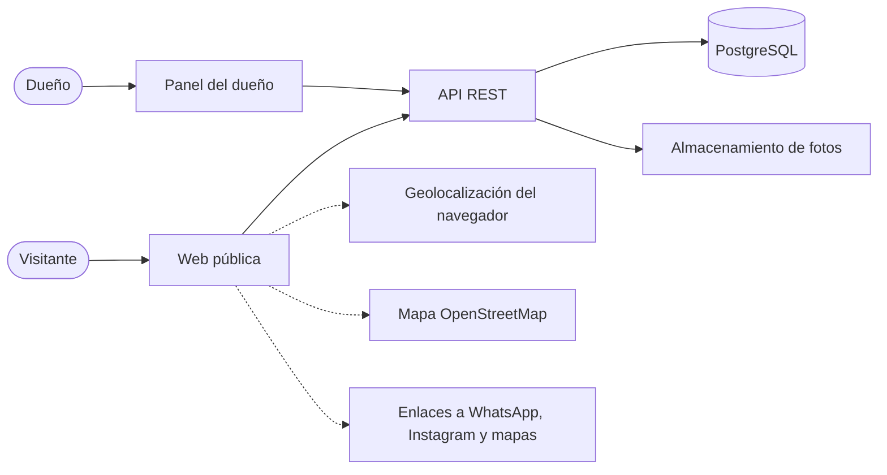
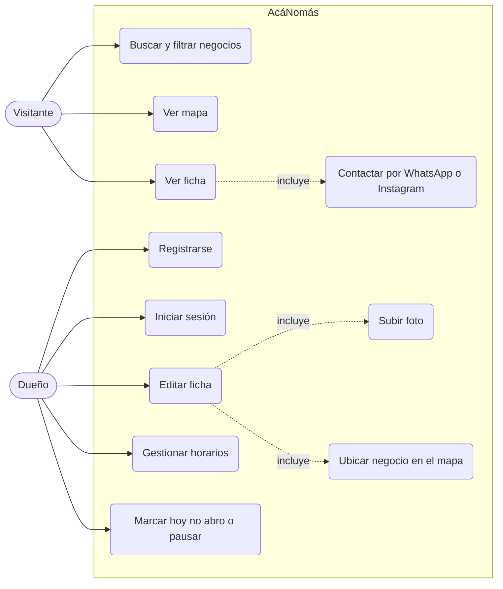
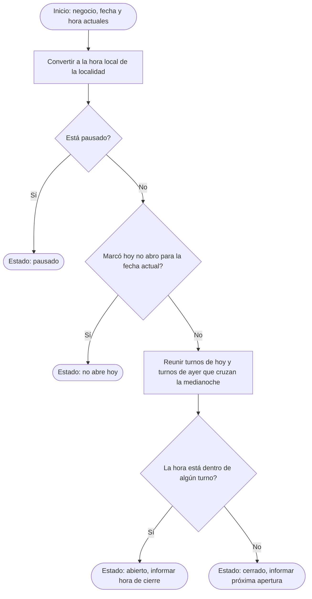

# AcáNomás — Especificación de Requisitos de Software (ERS)

## Historial de versiones

| Versión | Fecha | Autor | Cambios |
|---|---|---|---|
| 0.1 | 30/10/2026 | Equipo AcáNomás | Borrador inicial |
| 0.2 | 03/11/2026 | Equipo AcáNomás | Se actualiza el estado del modelo de datos en la sección 10 |
| 0.3 | 06/11/2026 | Tobias | La localidad inicial pasa a ser Mantilla, Corrientes |

---

## 1. Introducción

### 1.1 Propósito
Este documento describe qué es AcáNomás, para quién es y qué debe hacer el sistema en su primera versión (MVP). Sirve de referencia común para el equipo y como documentación del proyecto.

### 1.2 Alcance
AcáNomás es un directorio web de los negocios y emprendimientos de una localidad (inicialmente Mantilla, Corrientes). Permite a los vecinos encontrar lo que necesitan cerca, saber si está **abierto ahora** y contactar al negocio por WhatsApp o Instagram. Permite a los dueños cargar y mantener su propia ficha y sus horarios.

**Incluye (MVP):** exploración y búsqueda, ficha de negocio, mapa, cuentas de dueños, gestión de ficha y fotos, gestión de horarios.
**No incluye:** ver sección 9.

### 1.3 Problema que resuelve
- Los emprendimientos locales no aparecen en los mapas, o aparecen con datos viejos.
- Viven en redes sociales de contenido efímero y se encuentran por boca en boca.
- Casi nunca se sabe si están abiertos en este momento.
- Los emprendedores no tienen sitio web ni presupuesto para publicidad.

### 1.4 Glosario

| Término | Definición |
|---|---|
| Negocio (`business`) | Comercio o emprendimiento publicado en el directorio |
| Ficha (`listing`) | Página pública con la información de un negocio |
| Dueño (`owner`) | Usuario que administra uno o más negocios |
| Visitante | Persona que navega el directorio sin cuenta |
| Rubro (`category`) | Categoría del negocio (comida, indumentaria, etc.) |
| Localidad (`locality`) | Ciudad o pueblo al que pertenece un negocio |
| Abierto ahora (`isOpenNow`) | Estado calculado a partir de los horarios y la hora local |
| Turno | Rango horario de atención dentro de un día |
| Slug | Identificador legible del negocio usado en la URL |
| MVP | Primera versión entregable del producto |

---

## 2. Descripción general

### 2.1 Perspectiva del producto
Tres componentes: una **web pública** para visitantes, un **panel** para dueños y una **API REST** que sirve a ambos y accede a la base de datos (ver diagrama de contexto, sección 8).

### 2.2 Usuarios

| Usuario | Descripción | Necesidad principal |
|---|---|---|
| **Visitante** | Vecino que busca algo cerca. No necesita cuenta | Encontrar rápido y saber si puede ir ya |
| **Dueño** | Emprendedor o comerciante con cuenta | Aparecer cuando lo buscan, sin saber de tecnología |
| **Administrador** | Gestiona el sistema | Fuera del MVP |

### 2.3 Restricciones
- Plazo: entrega a mediados de diciembre de 2026.
- Equipo de cuatro personas.
- Stack: Node.js, Express 5, TypeScript, Zod, Prisma, PostgreSQL.
- Repositorio público: se usan solo datos ficticios.
- Código, base de datos y API en inglés; interfaz y documentación en español.

### 2.4 Suposiciones y dependencias
- Los dueños cargan y mantienen sus propios horarios.
- Los visitantes usan navegadores con soporte de geolocalización (pueden negarla).
- Los enlaces a WhatsApp, Instagram y mapas dependen de servicios externos.

### 2.5 Prioridad de los requisitos
Todos los requisitos listados pertenecen al MVP. La prioridad (Alta, Media) indica **el orden de construcción y qué se recorta último** si el plazo se complica; no divide el MVP en dos.

---

## 3. Requisitos funcionales

### EP-01 Exploración

| ID | Requisito | Prioridad | Criterio de aceptación |
|---|---|---|---|
| RF-01 | El sistema mostrará un listado paginado de los negocios de la localidad | Alta | Devuelve `page`, `limit` y `total`; 20 por página por defecto |
| RF-02 | El visitante podrá buscar por texto | Alta | Busca en nombre y descripción sin distinguir mayúsculas ni tildes |
| RF-03 | El visitante podrá filtrar por rubro | Alta | Solo se listan negocios del rubro elegido |
| RF-04 | El visitante podrá filtrar por "abierto ahora" | Alta | Solo se listan negocios cuyo estado calculado es abierto |
| RF-05 | El listado se ordenará con los abiertos primero y luego por cercanía | Alta | Sin ubicación del visitante, el desempate es por nombre |
| RF-06 | El sistema mostrará la distancia al visitante si este concede su ubicación | Media | Menos de 1 km se muestra en metros; si no, en km con un decimal |
| RF-07 | El sistema mostrará los negocios en un mapa | Media | Cada negocio es un pin que indica abierto o cerrado; al tocarlo se abre su ficha |

### EP-02 Ficha de negocio

| ID | Requisito | Prioridad | Criterio de aceptación |
|---|---|---|---|
| RF-08 | Cada negocio tendrá una página propia accesible por su slug | Alta | `/businesses/:slug` devuelve la ficha o error 404 |
| RF-09 | La ficha mostrará el estado actual, el horario de hoy y el horario semanal | Alta | Coincide con el resultado de la regla RN-01 |
| RF-10 | La ficha ofrecerá botones de WhatsApp, Instagram y "Cómo llegar" | Alta | Solo aparecen los canales que el dueño activó (RN-06) |
| RF-11 | La ficha mostrará la foto del negocio si existe | Media | Sin foto se muestra un marcador por defecto |
| RF-12 | La ficha tendrá un enlace compartible | Alta | La URL funciona en una pestaña nueva sin sesión |

### EP-03 Cuentas de dueños

| ID | Requisito | Prioridad | Criterio de aceptación |
|---|---|---|---|
| RF-13 | El dueño podrá registrarse con email y contraseña | Alta | Email único; contraseña con al menos 8 caracteres; guardada con hash |
| RF-14 | El dueño podrá iniciar y cerrar sesión | Alta | Credenciales inválidas devuelven error genérico; hay límite de intentos |
| RF-15 | Las operaciones del panel requerirán sesión válida | Alta | Sin sesión: 401. Sobre una ficha ajena: 403 |

### EP-04 Gestión de la ficha

| ID | Requisito | Prioridad | Criterio de aceptación |
|---|---|---|---|
| RF-16 | El dueño podrá crear y editar su ficha: nombre, rubro y descripción corta | Alta | Nombre obligatorio; descripción de hasta 80 caracteres |
| RF-17 | El dueño cargará sus datos de contacto y elegirá cuáles son públicos | Alta | Cada canal (WhatsApp, Instagram) es opcional y tiene un interruptor de visibilidad |
| RF-18 | El dueño podrá indicar medios de pago y si hace entregas | Media | Se muestran como etiquetas en la ficha |
| RF-19 | El dueño marcará la ubicación de su negocio en un mapa | Media | Guarda latitud y longitud; el pin se ve en el mapa público |
| RF-20 | El dueño podrá subir una foto de su local | Media | JPG, PNG o WebP de hasta 5 MB; otros formatos se rechazan |
| RF-21 | El dueño verá una vista previa de cómo se ve su ficha | Media | La vista previa refleja los cambios sin guardar |

### EP-05 Horarios y estado

| ID | Requisito | Prioridad | Criterio de aceptación |
|---|---|---|---|
| RF-22 | El dueño cargará un horario semanal con hasta dos turnos por día | Alta | Los turnos de un mismo día no pueden superponerse |
| RF-23 | El dueño podrá copiar el horario de un día al resto | Media | Reemplaza los demás días tras confirmar |
| RF-24 | El dueño podrá marcar "hoy no abro" | Alta | Solo afecta a la fecha local actual |
| RF-25 | El dueño podrá pausar el negocio (vacaciones) hasta reactivarlo | Alta | Un negocio pausado aparece como pausado y nunca como abierto |
| RF-26 | El panel mostrará el estado actual del negocio | Media | Indica abierto, cerrado, no abre hoy o pausado, con el motivo |

---

## 4. Reglas de negocio

| ID | Regla |
|---|---|
| **RN-01** | **Abierto ahora.** El estado se calcula en la hora local de la localidad (`America/Argentina/Buenos_Aires`). Precedencia: (1) pausado, (2) "hoy no abro" para la fecha actual, (3) horario semanal. Un negocio está abierto si la hora cae dentro de algún turno, con inicio **inclusive** y fin **exclusivo** |
| **RN-02** | Un turno cuyo fin es menor o igual a su inicio cruza la medianoche. Un turno de lunes 19:00–03:00 mantiene abierto el negocio el martes hasta las 03:00 |
| **RN-03** | Un día sin turnos cargados se considera cerrado |
| **RN-04** | Si el negocio está cerrado, el sistema informa la próxima apertura; si está abierto, la hora de cierre |
| **RN-05** | El slug se genera a partir del nombre, es único y no cambia aunque se edite el nombre |
| **RN-06** | Los canales de contacto son opcionales y el dueño decide cuáles son públicos |
| **RN-07** | Un dueño solo puede modificar sus propios negocios |
| **RN-08** | Las fichas nuevas se publican de inmediato (sin aprobación en el MVP) |
| **RN-09** | La distancia se calcula entre la ubicación del visitante y la del negocio (fórmula de Haversine) |
| **RN-10** | `isOpenNow` es una función pura: recibe horarios, fecha/hora actual y zona horaria, y no lee el reloj del sistema |

---

## 5. Requisitos no funcionales

| ID | Categoría | Requisito |
|---|---|---|
| RNF-01 | Usabilidad | Diseño responsive, pensado primero para celular, con poco texto en pantalla |
| RNF-02 | Accesibilidad | Contraste suficiente, navegación por teclado y etiquetas en los controles (objetivo WCAG AA básico) |
| RNF-03 | Rendimiento | El listado responde en menos de 500 ms con 500 negocios (valor a validar) |
| RNF-04 | Seguridad | Contraseñas con bcrypt; JWT en cookie `httpOnly`; límite de intentos de login; `helmet`; CORS restringido; validación de toda entrada con Zod |
| RNF-05 | Seguridad | Sin secretos en el repositorio; `.env` ignorado y `.env.example` de muestra |
| RNF-06 | Datos | Solo datos ficticios en el repositorio y el seed |
| RNF-07 | Mantenibilidad | Arquitectura por capas, organizada en módulos, con puertos y adaptadores en los bordes |
| RNF-08 | Mantenibilidad | ESLint, Prettier, commits convencionales y revisión de PR obligatoria |
| RNF-09 | Calidad | Pruebas unitarias de las reglas de negocio (Vitest), pruebas de la API (Postman) y flujos principales end-to-end (Playwright) |
| RNF-10 | Portabilidad | Entorno de desarrollo reproducible con Docker |
| RNF-11 | Interoperabilidad | Errores con formato `{ error: { code, message, details } }`; paginación con `page` y `limit`; fechas en ISO 8601 UTC |
| RNF-12 | Idioma | Interfaz solo en español |

---

## 6. Interfaces externas

| Interfaz | Uso |
|---|---|
| WhatsApp (`wa.me`) | Botón de contacto con un mensaje inicial |
| Instagram | Enlace al perfil del negocio |
| Enlace de mapas | "Cómo llegar" con las coordenadas del negocio |
| OpenStreetMap + Leaflet | Mapa público y selector de ubicación del dueño |
| API de geolocalización del navegador | Ubicación del visitante, con su permiso |
| Supabase (PostgreSQL y Storage) | Base de datos y fotos en staging y producción |

---

## 7. Stack y arquitectura (resumen)

- **Backend:** Node.js, Express 5, TypeScript, Zod, Prisma.
- **Base de datos:** PostgreSQL. Local con Docker en desarrollo y pruebas; Supabase en staging y producción, usado solo como base de datos.
- **Calidad:** Vitest, Postman, Playwright, ESLint, Prettier, GitHub Actions.
- **Arquitectura:** monolito modular con arquitectura en capas (controllers → services → repositories), con inversión de dependencias en los bordes mediante puertos (`shared/ports`) y adaptadores (`infrastructure`).
- Detalle y motivos: ver `docs/decisiones.md`.

---

## 8. Diagramas

### 8.1 Contexto del sistema

### 8.2 Casos de uso

### 8.3 Actividad: cálculo de "abierto ahora" (RN-01 a RN-04)

---

## 9. Fuera del MVP

Cartel con QR para compartir, métricas para el dueño, ferias y eventos, cuentas de vecinos y favoritos, enlace mágico por email, varias localidades, panel de administración, aprobación de fichas, administración de rubros, días especiales y feriados en los horarios, changas y oficios, bot de WhatsApp y búsqueda con IA.

---

## 10. Decisiones pendientes de confirmar

| Tema | Valor por defecto | Estado |
|---|---|---|
| Localidad inicial | Mantilla, Corrientes | Resuelta |
| Aprobación de fichas nuevas | Se publican de inmediato | A confirmar |
| Un dueño con varios negocios | El modelo lo permite; la interfaz del MVP muestra uno | A confirmar |
| Rubros disponibles | Lista fija chica cargada por seed | A definir |
| Hosting del primer despliegue | Sin definir | Pendiente |
| Modelo de datos detallado | Propuesto en D-22 y en `docs/diagramas/modelo-de-datos.md` | En revisión del equipo |