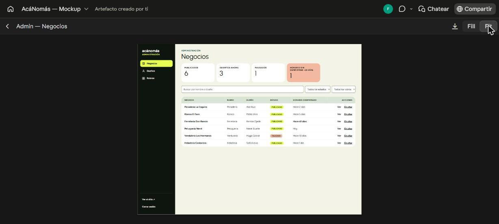
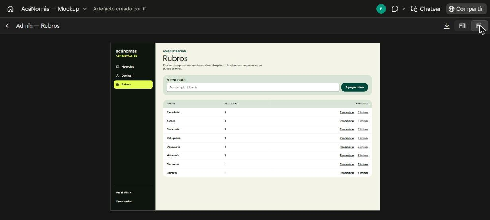

# Mockup — Administración

Qué muestran las pantallas de administración del mockup. **No entran en el MVP:** el panel de administración y la administración de rubros son de fase 2, y los rubros se cargan con el seed (sección 2 de [`docs/diseno.md`](../diseno.md)). Se describen solo para reconocerlas.

## Historial de versiones

| Versión | Fecha | Autor | Cambios |
|---|---|---|---|
| 0.1 | 17/11/2026 | Tobias | Versión inicial: pantallas de administración |

## Índice

1. Admin — Negocios
2. Admin — Rubros

---

Las dos pantallas comparten un menú lateral oscuro con el logo, "Administración" y las secciones Negocios, Dueños y Rubros (la activa en `accent`); abajo, "Ver el sitio ↗" y "Cerrar sesión". Solo hay versión de escritorio.

## 1. Admin — Negocios

**Partes legibles:** [1](capturas/admin-1.jpg), [2](capturas/admin-2.jpg), [3](capturas/admin-3.jpg).

1. "Administración" y el título "Negocios".
2. Cuatro indicadores: Publicados, Abiertos ahora, Pausados y "Horario sin confirmar +30 días" (en `alert`).
3. Búsqueda por nombre o dueño y dos desplegables: estados y rubros.
4. Tabla con Negocio, Rubro, Dueño, Estado (Publicado o Pausado), Horario confirmado y las acciones "Ver" y "Ocultar".

El indicador y la columna de horario confirmado dependen de una funcionalidad que tampoco entra en el MVP (sección 2 de `diseno.md`).

## 2. Admin — Rubros

**Partes legibles:** [1](capturas/admin-rubros-1.jpg), [2](capturas/admin-rubros-2.jpg).

1. "Administración", el título "Rubros" y la aclaración de que un rubro con negocios no se puede eliminar.
2. Bloque "Nuevo rubro" con un campo y el botón "Agregar rubro".
3. Tabla con Rubro, Negocios (la cantidad) y las acciones "Renombrar" y "Eliminar".
