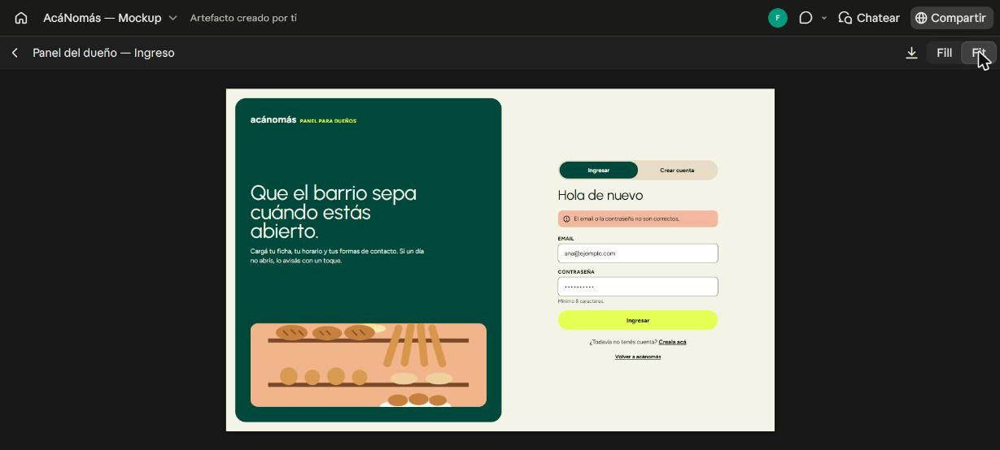
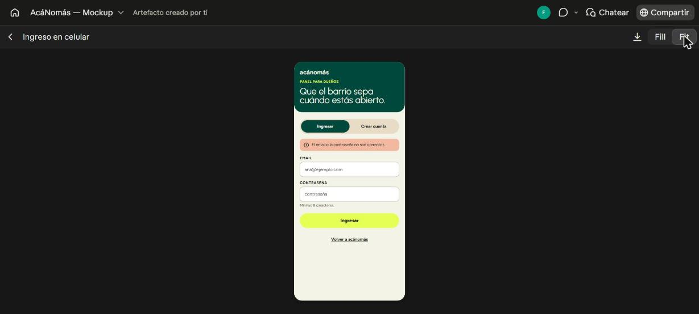
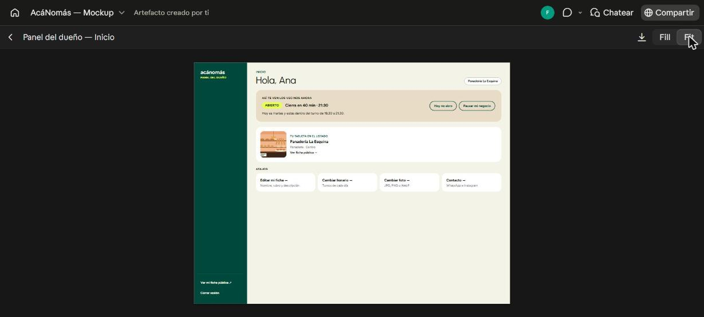
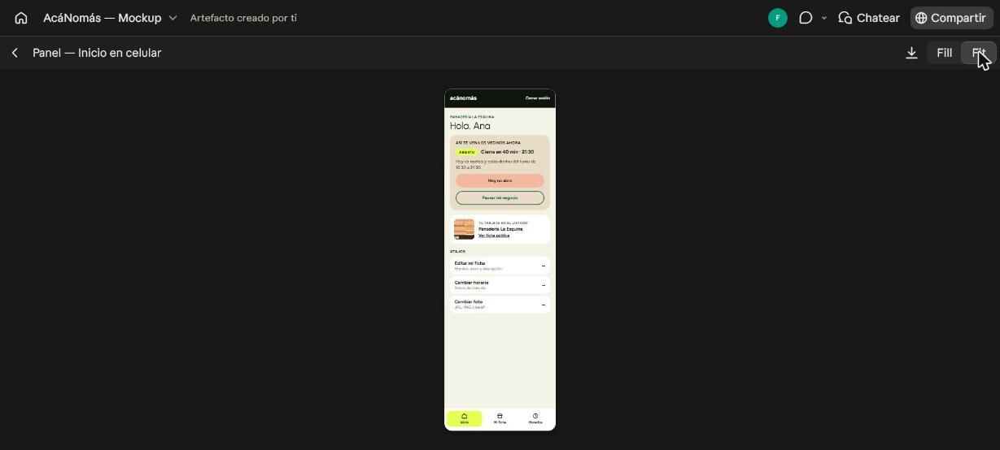
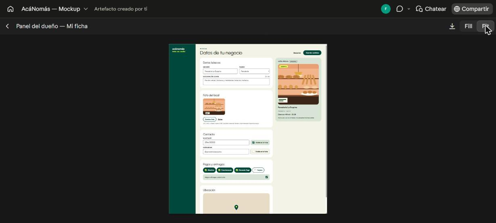
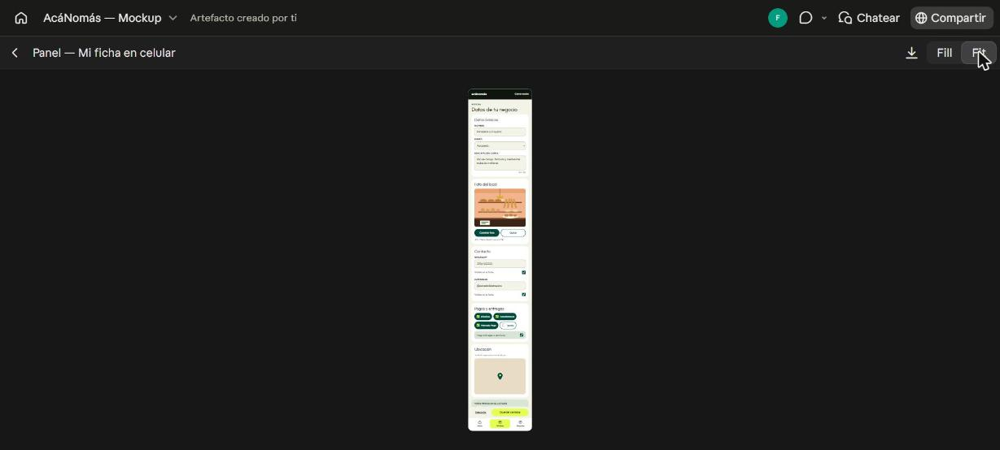
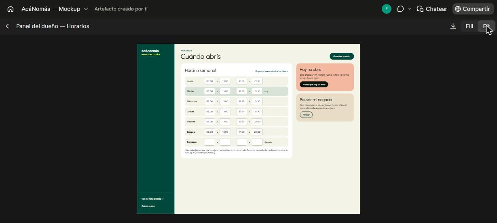
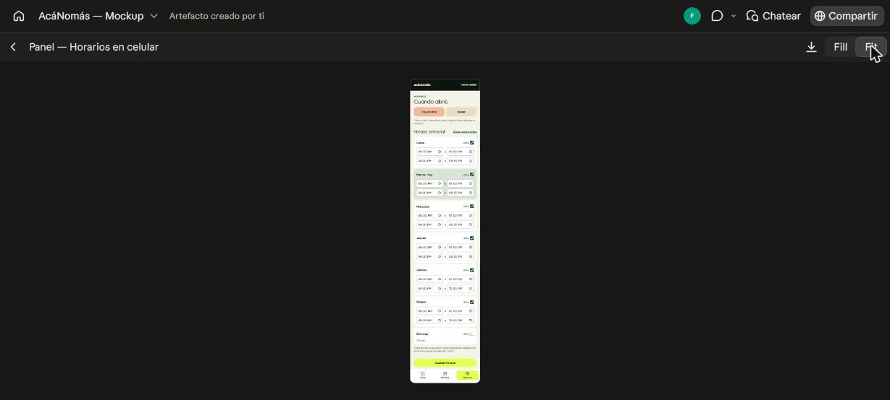

# Mockup — Panel del dueño

Qué muestra cada pantalla del panel del dueño en el mockup. Las reglas de uso están en [`docs/diseno.md`](../diseno.md) y el índice de capturas en [`README.md`](README.md).

## Historial de versiones

| Versión | Fecha | Autor | Cambios |
|---|---|---|---|
| 0.1 | 17/11/2026 | Tobias | Versión inicial: pantallas del panel |

## Índice

1. Estructura común
2. Ingreso
3. Inicio
4. Mi ficha
5. Horarios

---

## 1. Estructura común

- **Escritorio:** menú lateral `brand` con el logo y "Panel del dueño"; abajo, "Ver mi ficha pública ↗" y "Cerrar sesión". En las capturas el menú no muestra los enlaces de sección: los suma el `PanelLayout` (sección 10 de `diseno.md`).
- **Celular:** barra de arriba con el logo y "Cerrar sesión", y barra de pestañas abajo (Inicio, Mi ficha, Horarios), con la pestaña activa en `accent`. En Mi ficha y Horarios, el botón de guardar queda fijo sobre la barra de pestañas (sección 9 de `diseno.md`).
- Cada pantalla empieza con una etiqueta en mayúsculas (la sección) y un título grande.

## 2. Ingreso

**Partes legibles:** escritorio [1](capturas/login-1.jpg), [2](capturas/login-2.jpg); celular [1](capturas/login-movil-1.jpg), [2](capturas/login-movil-2.jpg).

Historias: US-12 y US-13.

| Bloque | Escritorio | Celular |
|---|---|---|
| Presentación | Bloque `brand` a la izquierda: logo, "Panel para dueños", "Que el barrio sepa cuándo estás abierto.", un texto y una ilustración | Bloque `brand` arriba con el logo y el título, sin ilustración |
| Pestañas | "Ingresar" (activa) y "Crear cuenta" | Igual |
| Formulario | "Hola de nuevo", mensaje de error, Email, Contraseña con la ayuda "Mínimo 8 caracteres." y "Ingresar" (`accent`) | Igual, sin "Hola de nuevo" |
| Enlaces | "¿Todavía no tenés cuenta? Creala acá" y "Volver a acánomás" | "Volver a acánomás" |

**Estado que muestra:** error de credenciales, sobre `alert`: "El email o la contraseña no son correctos."

**Lo que el mockup no muestra:** el formulario de registro (US-12). Solo está la pestaña "Crear cuenta"; lo plantea quien arma la pantalla (sección 2 de `diseno.md`).

## 3. Inicio

**Partes legibles:** escritorio [1](capturas/panel-1.jpg), [2](capturas/panel-2.jpg), [3](capturas/panel-3.jpg); celular [1](capturas/panel-movil-1.jpg), [2](capturas/panel-movil-2.jpg), [3](capturas/panel-movil-3.jpg).

Historias: US-23 a US-25.

1. "Inicio" y "Hola, Ana". En escritorio, a la derecha, una píldora con el nombre del negocio; en celular, el nombre va arriba del saludo.
2. Bloque `sand` "Así te ven los vecinos ahora": etiqueta de estado, "Cierra en 40 min · 21:30" y el motivo ("Hoy es martes y estás dentro del turno de 16:30 a 21:30."). Botones "Hoy no abro" y "Pausar mi negocio": al costado en escritorio; uno debajo del otro en celular, con "Hoy no abro" en `alert`.
3. "Tu tarjeta en el listado": la miniatura, el nombre, el rubro y "Ver ficha pública →".
4. "Atajos": tarjetas en fila en escritorio (Editar mi ficha, Cambiar horario, Cambiar foto, Contacto) y lista en celular (las tres primeras).

**Estado que muestra:** abierto. "Horario confirmado hace X días" no entra (sección 2 de `diseno.md`) y ya no está.

## 4. Mi ficha

**Partes legibles:** escritorio [1](capturas/panel-ficha-1.jpg), [2](capturas/panel-ficha-2.jpg), [3](capturas/panel-ficha-3.jpg), [4](capturas/panel-ficha-4.jpg), [5](capturas/panel-ficha-5.jpg); celular [1](capturas/panel-ficha-movil-1.jpg), [2](capturas/panel-ficha-movil-2.jpg), [3](capturas/panel-ficha-movil-3.jpg), [4](capturas/panel-ficha-movil-4.jpg), [5](capturas/panel-ficha-movil-5.jpg).

Historias: US-15 a US-20. En escritorio, el formulario va a la izquierda y la vista previa a la derecha; en celular, todo en una columna.

| Bloque | Qué tiene | Historia |
|---|---|---|
| Encabezado | "Mi ficha", "Datos de tu negocio", "Descartar" y "Guardar cambios" (en celular, fijos abajo) | US-15 |
| Datos básicos | Nombre, Rubro (desplegable) y Descripción corta con contador ("53 / 80") | US-15 |
| Foto del local | La foto, "Cambiar foto", "Quitar" y un texto con los formatos permitidos | US-19 |
| Contacto | WhatsApp e Instagram, cada uno con la casilla "Visible en la ficha" | US-16 |
| Pagos y entregas | Píldoras con casilla (Efectivo, Transferencia, Mercado Pago, Tarjeta) y la casilla de entregas a domicilio | US-17 |
| Ubicación | Mapa con un pin y "Tocá el mapa para mover el pin" | US-18 |
| Vista previa | Escritorio: bloque `mint` "Vista previa" con la tarjeta del listado. Celular: "Vista previa en el listado", al final | US-20 |

## 5. Horarios

**Partes legibles:** escritorio [1](capturas/panel-horarios-1.jpg), [2](capturas/panel-horarios-2.jpg), [3](capturas/panel-horarios-3.jpg); celular [1](capturas/panel-horarios-movil-1.jpg), [2](capturas/panel-horarios-movil-2.jpg), [3](capturas/panel-horarios-movil-3.jpg), [4](capturas/panel-horarios-movil-4.jpg).

Historias: US-21 a US-24.

| Bloque | Escritorio | Celular |
|---|---|---|
| Encabezado | "Horarios", "Cuándo abrís" y "Guardar horario" | Igual; "Guardar horario" fijo abajo |
| Hoy no abro y pausa | A la derecha: bloque `alert` "Hoy no abro" con "Avisar que hoy no abro", y bloque `sand` "Pausar mi negocio" con "Pausar" | Dos botones arriba del horario: "Hoy no abro" y "Pausar" |
| Horario semanal | Una fila por día con dos turnos (desde y hasta); hoy resaltado en `mint` con "Hoy"; un día sin turnos dice "Cerrado". Enlace para copiar un día a todos | Una tarjeta por día, con su casilla y los dos turnos en campos de hora. Mismo enlace para copiar |
| Ayuda | Texto debajo: hasta dos turnos por día, un día sin turnos es cerrado y cómo cargar un cierre después de medianoche | Igual |

"Horario confirmado" y "Sí, confirmo mi horario" no entran (sección 2 de `diseno.md`) y ya no están.
