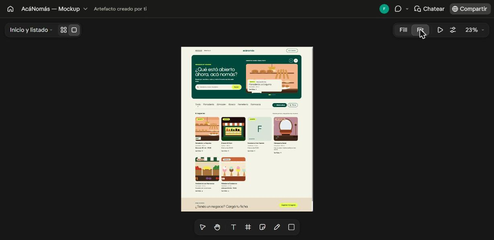
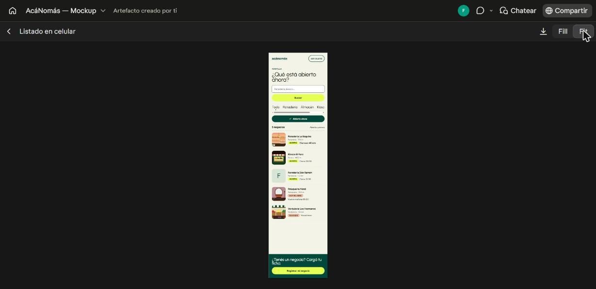
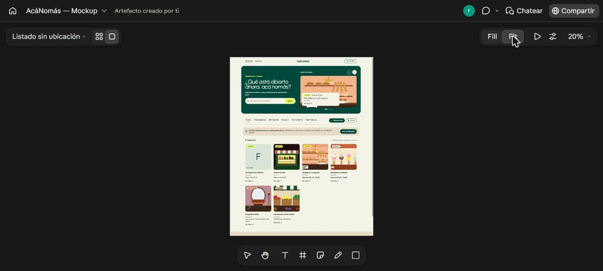
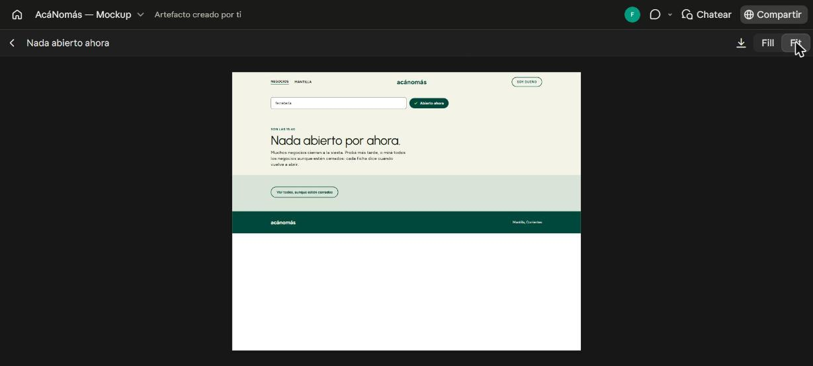
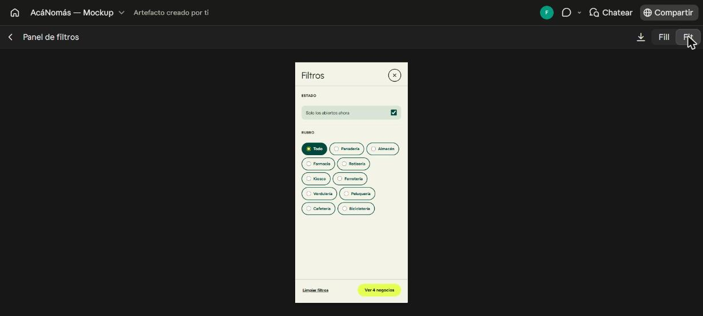
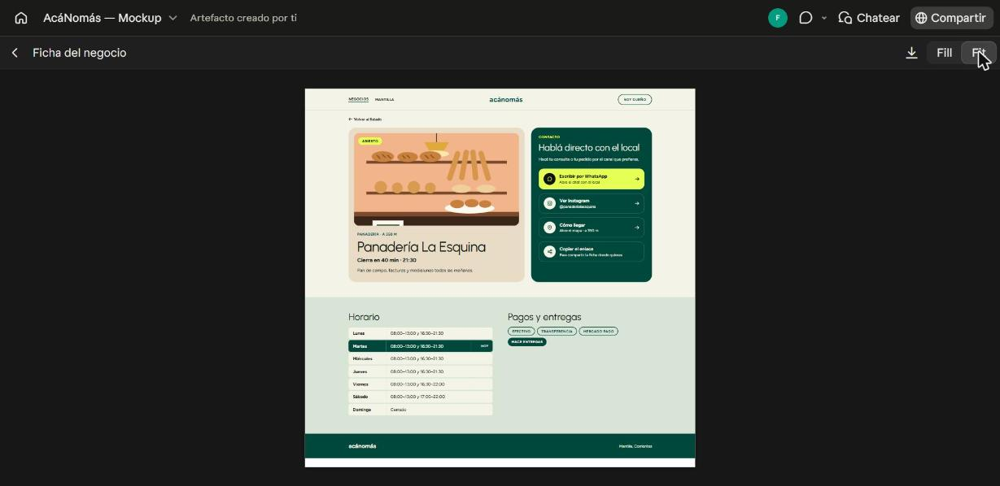
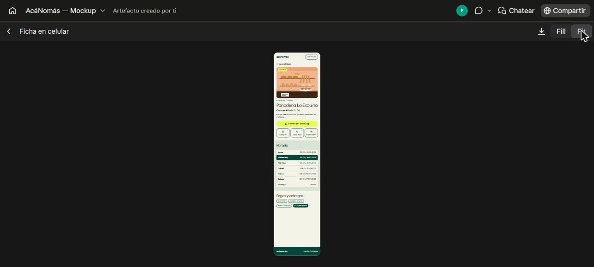
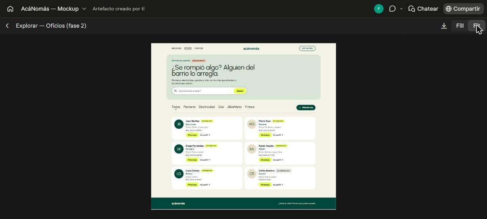
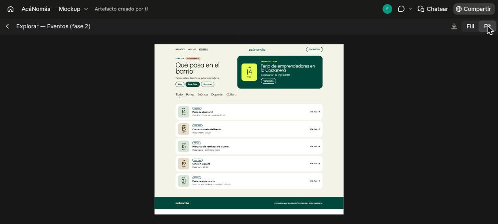

# Mockup — Web pública

Qué muestra cada pantalla de la web pública en el mockup, con el detalle del listado (US-01). Las reglas de uso están en [`docs/diseno.md`](../diseno.md) y el índice de capturas en [`README.md`](README.md).

## Historial de versiones

| Versión | Fecha | Autor | Cambios |
|---|---|---|---|
| 0.1 | 17/11/2026 | Tobias | Versión inicial: pantallas de la web y detalle del listado |
| 0.2 | 17/11/2026 | Tobias | Actualiza los enlaces a las capturas renombradas del listado y de los filtros en celular |
| 0.3 | 21/11/2026 | Tobias | Sección 5: qué arma US-08 en la ficha, qué queda para otras historias y cómo es la página 404 |
| 0.4 | 22/11/2026 | Tobias | US-09 define el texto de estado de la ficha (D-49). Sección 5: qué arma US-09 y en qué se aparta del mockup, incluida la distribución del horario en escritorio |

## Índice

1. Inicio y listado (escritorio y celular)
2. Listado sin ubicación
3. Nada abierto ahora
4. Panel de filtros
5. Ficha del negocio (escritorio y celular)
6. Explorar — Oficios y Eventos (fase 2)

---

## 1. Inicio y listado

**Partes legibles:** escritorio [1](capturas/inicio-y-listado-1.jpg) (encabezado y portada), [2](capturas/inicio-y-listado-2.jpg) (rubros y primeras tarjetas), [3](capturas/inicio-y-listado-3.jpg) (tarjetas), [4](capturas/inicio-y-listado-4.jpg) (últimas tarjetas, banda para dueños y pie). Celular [1](capturas/inicio-y-listado-movil-1.jpg) (encabezado, buscador y rubros), [2](capturas/inicio-y-listado-movil-2.jpg) (filas), [3](capturas/inicio-y-listado-movil-3.jpg) (última fila y pie).

### Estructura, de arriba hacia abajo

| Bloque | Escritorio | Celular |
|---|---|---|
| Encabezado | "Negocios" y "Mantilla" a la izquierda, logo al centro, "Soy dueño" a la derecha | Logo y "Soy dueño" |
| Portada | Bloque `brand` con "Negocios de tu barrio", el título "¿Qué está abierto ahora, acá nomás?", un texto y el buscador; a la derecha, el carrusel "Abiertos ahora cerca tuyo" con flechas y puntos | "Mantilla", el título "¿Qué está abierto ahora?", el campo de búsqueda y el botón "Buscar" debajo. Sin carrusel |
| Rubros y filtros | Pestañas de rubros (Todo, Panadería, Almacén, Kiosco, Ferretería, Farmacia) con un punto bajo la elegida; a la derecha, "Abierto ahora" y "Filtros". Línea `line` debajo | Pestañas que se desplazan de costado y "Abierto ahora" a todo el ancho. Sin "Filtros" |
| Encabezado del listado | "6 negocios" y "Abiertos primero, después los más cercanos" | "5 negocios" y "Abiertos primero", con una línea `line` debajo |
| Listado | Grilla de tarjetas | Filas |
| Para dueños | Banda `sand` con "Para dueños", "¿Tenés un negocio? Cargá tu ficha." y "Registrar mi negocio" | Dentro del pie `brand` |
| Pie | Bloque `brand` con el logo y "Mantilla, Corrientes" | — |

### Estados que muestra

Los cuatro estados de un negocio (sección 7 de `diseno.md`): **Abierto** (Panadería, Kiosco, Ferretería), **Hoy no abre** (Peluquería), **Pausado** (Verdulería) y **Cerrado** (Heladería). Un negocio sin foto (Ferretería) muestra la inicial sobre `mint` y, en escritorio, "Sin foto". El texto de estado va en negrita cuando el cambio es cercano ("Cierra en 40 min · 21:30", "Abre en 20 min · 15:00").

### La tarjeta y la fila

**Escritorio (tarjeta):**
1. Foto cuadrada con esquinas redondeadas. Sin foto: fondo `mint`, la inicial grande en `brand` y "Sin foto" abajo a la izquierda.
2. Etiqueta de estado arriba a la izquierda, sobre la foto.
3. Nombre (18 px, negrita).
4. Rubro y distancia en `muted` ("Panadería · 350 m").
5. Texto de estado ("Cierra a las 02:00").
6. "Ver ficha →".

**Celular (fila):**
1. Miniatura cuadrada de 92 px a la izquierda (sin foto: la inicial sobre `mint`).
2. A la derecha: nombre (16 px, negrita), rubro y distancia en `muted`, y la etiqueta de estado con un texto corto al lado ("Cierra 02:00", "Vacaciones").
3. Toda la fila es el enlace a la ficha. No hay "Ver ficha".
4. Las filas se separan con una línea `mint`.

### Medidas por ancho

Se arma primero para 390 px y se agranda con los prefijos de Tailwind (sección 9 de `diseno.md`). El mockup usa una grilla automática (`minmax(240px, 1fr)`); la web fija las columnas por ancho:

| Ancho | Prefijo | Distribución |
|---|---|---|
| Desde 0 (se diseña a 390) | sin prefijo | Una columna de filas. Miniatura `size-23` (92 px), separación `gap-3.5` y `py-3.5`, línea `border-mint` debajo |
| 640 px (tablet) | `sm:` | Dos columnas de tarjetas con la foto cuadrada arriba y la etiqueta sobre la foto. Separación `gap-x-6 gap-y-10` (24 y 40 px, como el mockup) |
| 1024 px (escritorio) | `lg:` | Tres columnas |
| 1280 px | `xl:` | Cuatro columnas, hasta `max-w-page` (1120 px) |

### Colores y formas: del mockup a los tokens

| Valor del mockup | Token | Clase | Dónde |
|---|---|---|---|
| `#F4F3E7` | `paper` | `bg-paper` | Fondo de la página |
| `#0E150E` | `ink` | `text-ink` | Texto principal y borde de las etiquetas |
| `#00473C` | `brand` | `text-brand`, `bg-brand` | Inicial y "Sin foto"; botón "Abierto ahora"; portada y pie |
| `#E6FF55` | `accent` | `bg-accent` | Etiqueta "Abierto", botón "Buscar" |
| `#F2B8A0` | `alert` | `bg-alert` | Etiquetas "Hoy no abre" y "Pausado" |
| `#D8E5D6` | `mint` | `bg-mint`, `border-mint` | Fondo de la foto que falta; línea entre filas en celular |
| `#555555` | `muted` | `text-muted` | Rubro y distancia |
| `#8C8C82` | `line` | `border-line` | Línea bajo los rubros y bajo el encabezado del listado en celular |
| Esquina de 20 px (tarjeta) | `rounded-card` (24 px) | `rounded-card` | Foto de la tarjeta. La sección 6 de `diseno.md` admite de 20 a 28 px |
| Esquina de 16 px (miniatura del celular) | sin token propio | `rounded-card` | Miniatura de la fila. No se agrega un token solo para esto |
| Esquina de 20 px (etiqueta) | píldora | `rounded-full` | Etiquetas de estado (sección 6) |

### Qué hace US-01 y qué queda para otras historias

US-01 arma el listado: encabezado del listado con la cantidad, la grilla o las filas, y cada negocio con la inicial, el nombre, el rubro y la etiqueta de estado que devuelve la API.

| Parte del mockup | Historia |
|---|---|
| Buscador de la portada | US-02 |
| Pestañas de rubros y "Filtros" | US-03 |
| "Abierto ahora" | US-04 |
| "Abiertos primero, después los más cercanos" | US-05 |
| Distancia ("· 350 m") | US-06 |
| Mapa (no está en el mockup) | US-07 |
| "Ver ficha" y el enlace de la fila | US-08 |
| Foto del negocio | US-11 (la sube el dueño en US-19) |
| Texto de estado ("Cierra a las…", "Vuelve mañana…") | Fuera de US-01. HT-01 calcula la hora de cierre o la próxima apertura. US-09 define el texto de la ficha (D-49); el del listado, con el texto corto de la fila, queda para una historia propia |
| Carrusel "Abiertos ahora cerca tuyo" | Sin historia propia: muestra los primeros resultados del listado (sección 2 de `diseno.md`) |

**Paginación:** el mockup no la muestra, pero la API devuelve de a 20 negocios (D-25). Por eso el listado suma "Anterior" y "Siguiente" debajo de la grilla.

### Qué no entra en el MVP

Los enlaces del encabezado a Oficios y Eventos ya no están en esta pantalla. El resto de la pantalla entra.

## 2. Listado sin ubicación

**Partes legibles:** [1](capturas/sin-ubicacion-1.jpg), [2](capturas/sin-ubicacion-2.jpg), [3](capturas/sin-ubicacion-3.jpg), [4](capturas/sin-ubicacion-4.jpg), [5](capturas/sin-ubicacion-5.jpg).

Es la misma pantalla de inicio cuando el visitante no comparte su ubicación (US-05 y US-06). Cambia:
- El carrusel dice "Abiertos ahora" y las tarjetas del carrusel no llevan distancia.
- Entre los rubros y el listado aparece un aviso `sand` con un ícono de ubicación: "**Activá tu ubicación para ver qué te queda cerca.** Mientras tanto, ves todos los negocios de Mantilla, con los abiertos primero." y el botón "Usar mi ubicación".
- El encabezado del listado dice "Abiertos primero, después por nombre" y las tarjetas cambian de orden.

No tiene versión de celular: la arma quien hace US-06 (sección 1 de `diseno.md`).

## 3. Nada abierto ahora

**Partes legibles:** [1](capturas/vacio-1.jpg), [2](capturas/vacio-2.jpg).

Estado vacío del filtro "Abierto ahora" (US-04).

1. Encabezado.
2. Campo de búsqueda (con "ferretería" escrito) y "Abierto ahora" activo.
3. "Son las 15:40", el título "Nada abierto por ahora." y un texto que invita a probar más tarde o ver todos.
4. Banda `mint` con el botón secundario "Ver todos, aunque estén cerrados".
5. Pie.

"Estos abren en la próxima hora" no entra (sección 2 de `diseno.md`) y ya no está en la pantalla.

## 4. Panel de filtros

**Partes legibles:** [1](capturas/filtros-movil-1.jpg), [2](capturas/filtros-movil-2.jpg).

Panel con ancho de celular que se abre desde "Filtros" (US-03 y US-04).

1. Título "Filtros" y botón para cerrar.
2. "Estado": casilla "Solo los abiertos ahora" sobre `mint`.
3. "Rubro": píldoras de opción única (Todo, Panadería, Almacén, Farmacia, Rotisería, Kiosco, Ferretería, Verdulería, Peluquería, Cafetería, Bicicletería). La elegida va en `brand`.
4. Abajo, fijos: "Limpiar filtros" y el botón "Ver 4 negocios".

Los filtros de entregas y medios de pago y la elección del orden no entran (sección 2 de `diseno.md`) y ya no están.

## 5. Ficha del negocio

**Partes legibles:** escritorio [1](capturas/ficha-1.jpg), [2](capturas/ficha-2.jpg), [3](capturas/ficha-3.jpg); celular [1](capturas/ficha-movil-1.jpg), [2](capturas/ficha-movil-2.jpg), [3](capturas/ficha-movil-3.jpg), [4](capturas/ficha-movil-4.jpg).

Historias: US-08 a US-11 y US-17.

| Bloque | Escritorio | Celular |
|---|---|---|
| Encabezado y "Volver al listado" | Igual que el listado | Igual |
| Datos | Bloque `sand` con la foto y la etiqueta de estado, rubro y distancia, nombre, texto de estado y descripción | Igual, a todo el ancho |
| Contacto | Bloque `brand` a la derecha: "Hablá directo con el local", con "Escribir por WhatsApp" (`accent`), "Ver Instagram", "Cómo llegar" y "Copiar el enlace" | "Escribir por WhatsApp" a todo el ancho y debajo tres botones en grilla: Instagram, Cómo llegar y Copiar enlace |
| Horario | Banda `mint` con la semana completa; el día de hoy resaltado en `brand` con "Hoy" | La semana en filas, hoy resaltado |
| Pagos y entregas | Etiquetas (Efectivo, Transferencia, Mercado Pago) y "Hace entregas" resaltada | Igual |
| Pie | Logo y "Mantilla, Corrientes" | Igual |

**Lo que el MVP pide y el mockup no muestra:** la página 404 de una ficha que no existe (US-08). Las partes de la ficha que no entran ("Compartir por WhatsApp", el mapa, "Reclamá la ficha", "Horario confirmado") ya no están.

### Qué hace US-08 y qué queda para otras historias

US-08 arma la ficha en `/negocios/[slug]`: "Volver al listado" y el bloque `sand` con el lugar de la foto, el rubro, el nombre y la descripción. Si el negocio no tiene descripción, no se muestra nada en su lugar.

| Parte del mockup | Historia |
|---|---|
| "Volver al listado", rubro, nombre y descripción | US-08 |
| "Copiar el enlace" | US-08. Mientras no exista el bloque de contacto, va en el bloque de datos, debajo de la descripción |
| Etiqueta de estado, texto de estado y horario de la semana | US-09. Ver abajo |
| Bloque de contacto: WhatsApp, Instagram y "Cómo llegar" | US-10. Al armarlo, "Copiar el enlace" pasa a ese bloque, como en el mockup |
| Foto del negocio | US-11 (la sube el dueño en US-19). Hasta entonces, la inicial sobre `mint` y "Sin foto" |
| Pagos y entregas | US-17 |
| Distancia | Sin historia: US-06 la pide solo para el listado |

**Página 404:** el mockup no la muestra. Es un bloque `mint` con "Error 404", el título "No encontramos este negocio", un texto corto y el botón "Ver todos los negocios", que lleva al listado. Ver D-46 en `docs/decisiones.md` sobre el código HTTP que devuelve.

### Qué hace US-09

US-09 suma a la ficha la etiqueta de estado, el texto de estado y el horario de la semana. Las reglas del texto y del horario están en D-49 de `docs/decisiones.md`; de dónde salen la zona horaria y la hora, en D-48.

Diferencias con el mockup:

| Mockup | Ficha | Por qué |
|---|---|---|
| Turnos "08–13 y 16:30–21:30" | "08:00 – 13:00 · 17:00 – 21:30" | Todas las horas con minutos, iguales en todos los días |
| "Cierra a las 02:00" pasada la medianoche | "Cierra mañana a las 02:00" | Sin "mañana" se leería como de hoy (D-49) |
| Horario en escritorio: banda `mint` de borde a borde | Bloque `mint` con esquinas redondeadas, dentro del ancho del contenido | Sigue el resto de los bloques de la ficha, que son tarjetas dentro de `max-w-page` |
| "HOY" al final de la fila en escritorio | "HOY" al lado del nombre del día en todos los anchos | Igual que el celular del mockup: una sola distribución para todos los anchos |
| Turnos en columna, alineados a la izquierda, en escritorio | Turnos alineados a la derecha en todos los anchos | Igual que el celular del mockup. Si no entran al lado del día, pasan al renglón de abajo sin desplazarse de costado |

## 6. Explorar — Oficios y Eventos (fase 2)

**No entran en el MVP** (sección 2 de `diseno.md`). Se describen solo para reconocerlas.

**Oficios** ([1](capturas/oficios-1.jpg), [2](capturas/oficios-2.jpg), [3](capturas/oficios-3.jpg)): portada `mint` "¿Se rompió algo? Alguien del barrio lo arregla." con buscador, pestañas de oficios y "Atiende hoy", y una grilla de tarjetas de personas (iniciales, oficio, zonas, horario de hoy, "WhatsApp" y "Ver perfil").

**Eventos** ([1](capturas/eventos-1.jpg), [2](capturas/eventos-2.jpg), [3](capturas/eventos-3.jpg)): "Qué pasa en el barrio" con selector de fecha (Hoy, Este finde, Este mes), un evento destacado en `brand`, pestañas por tipo y una lista de eventos con la fecha a la izquierda y "Ver más".

Las dos llevan en el encabezado los enlaces a Oficios y Eventos, que la web del MVP no tiene.
